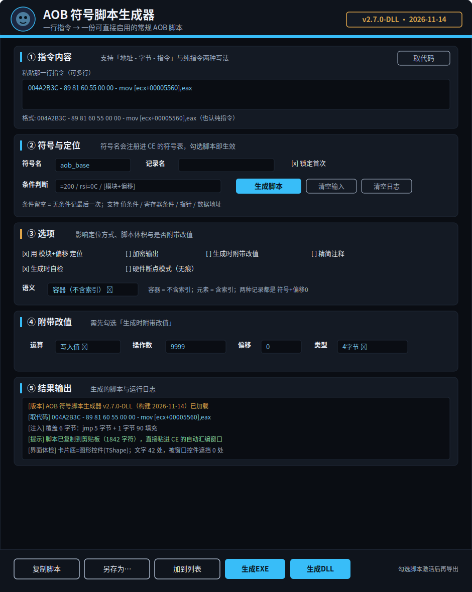

# AOB 符号脚本生成器 · 使用说明

> 工具名称：**AOB 符号脚本生成器**
> 版本：**v2.7.0-DLL**（构建日期 2026-11-14）
> 源文件：`AOB符号脚本生成器-新增无痕模式.lua`
> 运行环境：Cheat Engine（CE）的 Lua 插件

  

> 工具图标（取自脚本内嵌的 12 帧动画 logo，1:1 原图为 40×40）

---

## 界面一览

  

> 界面结构示意图：标题栏 + ①指令内容 ②符号与定位 ③选项 ④附带改值 ⑤结果输出 五大分区 + 底部固定工具条（根据脚本 UI 代码还原）。

---

## 下载

> **当前版本 v2.7.0-DLL**（构建 2026-11-14）· 单文件约 598 KB · 需配合 Cheat Engine 使用

如果按钮没显示，可直接用下面的链接：

- **直接下载（Raw）**：[AOB符号脚本生成器-新增无痕模式.lua](https://raw.githubusercontent.com/alj7800609/ce-/main/.aicode/attachments/AOB%E7%AC%A6%E5%8F%B7%E8%84%9A%E6%9C%AC%E7%94%9F%E6%88%90%E5%99%A8-%E6%96%B0%E5%A2%9E%E6%97%A0%E7%97%95%E6%A8%A1%E5%BC%8F.lua)
- **文件页面（在线查看 / 手动下载）**：[在 GitHub 打开文件](https://github.com/alj7800609/ce-/blob/main/.aicode/attachments/AOB%E7%AC%A6%E5%8F%B7%E8%84%9A%E6%9C%AC%E7%94%9F%E6%88%90%E5%99%A8-%E6%96%B0%E5%A2%9E%E6%97%A0%E7%97%95%E6%A8%A1%E5%BC%8F.lua)（打开后点右上角 `Raw` → 右键「另存为」）

| 项目 | 信息 |
| --- | --- |
| 文件名 | `AOB符号脚本生成器-新增无痕模式.lua` |
| 仓库路径 | `.aicode/attachments/AOB符号脚本生成器-新增无痕模式.lua` |
| 文件大小 | 612,238 字节（约 598 KB） |
| 版本 / 构建 | v2.7.0-DLL / 2026-11-14 |
| 格式 | 单文件 Lua（内含 C# / C++ 导出模块），UTF-8 |

---

## 一、工具简介

一句话概括：**一条指令进，一份常规 AOB 脚本出。**

在 CE 里通过「找出是什么访问了 / 改写了这个地址」拿到一条汇编指令后，本工具自动生成一段可直接启用的 AOB 注入脚本，并把指令执行时的基址寄存器写入一个符号。

脚本本身只做两件事：

1. 用 AOB 特征码定位这条指令；
2. 把指令执行时的基址寄存器写进符号。

改值、锁定等后续操作由 CE 地址列表自己完成（改值 / 冻结），工具不越权插手。

---

## 二、安装与入口

1. 把 `AOB符号脚本生成器-新增无痕模式.lua` 作为 Lua 脚本加载进 Cheat Engine（放到 CE 的 `autorun` 目录可随 CE 自动加载，或在 CE 中手动执行该脚本）。
2. 加载成功后：
   - **地址列表**右键菜单会出现入口 **「AOB 符号脚本生成」**，点击即可打开主窗体；
   - **内存查看器（Memory Viewer）反汇编区**右键可见 **「取选中代码到 AOB 生成器」**，或使用快捷键 `Ctrl + Shift + A` 取指令。
3. 打开生成器后，⑤「结果输出」区第一行会打印版本徽章，可据此确认加载的是不是最新文件。

---

## 三、快速上手（四步）

| 步骤 | 操作 |
| --- | --- |
| 1 | 在 CE 里对目标地址使用 **「找出是什么访问了 / 改写了这个地址」**，得到那条指令 |
| 2 | 把那一行指令粘进输入框（或在地址列表选中记录后点 **「取代码」**） |
| 3 | 点 **「生成脚本」**，把生成的脚本粘进 CE 的自动汇编窗口并勾选启用 |
| 4 | 地址列表新增记录：**地址填符号名 → 勾 Pointer → 偏移填日志提示里的值** |

> 输入格式示例（也认纯指令，空格不标准也能解析）：
> `004A2B3C - 89 81 60 55 00 00 - mov [ecx+00005560],eax`

---

## 四、界面分区说明

主窗体自上而下分为 5 张卡片 + 底部固定工具条：

- **① 指令内容**：右上角「取代码」按钮（优先取地址列表选中记录，没选则取内存查看器反汇编选中行/段）；下方多行输入框粘贴指令；支持「地址 - 字节 - 指令」与纯指令两种写法。
- **② 符号与定位**：设置符号名、记录名、锁定首次、条件判断；右侧是「生成脚本 / 清空输入 / 清空日志」按钮。
- **③ 选项**：影响定位方式、脚本体积、是否附带改值等（详见下表）。
- **④ 附带改值**：需先勾选「生成时附带改值」才可用，配置运算、操作数、偏移、类型。
- **⑤ 结果输出**：显示生成日志与提示信息。
- **底部工具条**（固定可见）：复制脚本 / 另存为… / 加到列表 / 生成EXE / 生成DLL。

---

## 五、选项说明（第③卡）

| 选项 | 作用 |
| --- | --- |
| 用 模块+偏移 定位 | 只在模块固定偏移附近十几个字节内扫描，保证唯一；游戏更新后扫不到会直接报错 |
| 加密输出 | 生成的脚本加密后再输出，启用时脚本自己解密再汇编；每次生成随机密钥（日志中会打印）。只挡直接抄脚本的人，非强加密 |
| 生成时附带改值 | 把改值指令写进注入代码（原指令执行完再写，不会被覆盖），勾选脚本即生效 |
| 精简注释 | 只保留指令行和定位行，去掉解释性注释，给熟手省篇幅 |
| 生成时自检 | 生成时对 AA 语法做自检（默认开启）；取消只跳过校验，不影响脚本本身 |
| 硬件断点模式 | 不写游戏代码，改用 CE 调试器的执行断点取寄存器，代码段保持干净（即文件名所称的「无痕模式」） |
| 语义（容器/元素） | 容器＝不含索引（基址+位移）；元素＝含索引（基址+索引×比例+位移）。两种记录都是「符号+偏移0」 |

**硬件断点模式的代价**：CE 调试器必须一直开着；每次命中会暂停全部线程；只有 4 个断点槽位；不能导出 EXE/DLL，也不能用「生成时附带改值」。

---

## 六、符号与条件判断（第②卡）

- **符号名**：生成脚本后可用它读写，默认 `aob_base`。
- **记录名**：自动加进地址列表的那条记录叫什么；留空则用「符号名+偏移」。
- **锁定首次**：符号有值后就不再改写，避免其它对象执行同一条指令时冲掉锁定的值（重启或重新启用脚本后重新锁）。
- **条件判断**：决定「什么时候记这次的值」，留空表示无条件记最后一次。支持形式：
  - 数据地址（如 `31089AE8`）
  - 指针（`[模块+偏移]`）
  - 值条件（`=200` / `>=100` / `100-200` / `&0x100`）
  - 寄存器条件（`rsi=0C` / `rcx!=5` / `rsi&0x100`）

---

## 七、附带改值（第④卡）

先勾选「生成时附带改值」启用本区，再配置：

| 字段 | 说明 |
| --- | --- |
| 运算 | 写入值 / 加 / 减 / 乘 / 除 / 取模 / 置0 / 与 / 或 / 异或 / 取反 |
| 操作数 | 写入或运算的值，支持 `9999` 或 `0x270F` 写法 |
| 偏移 | 相对符号地址的偏移，一般填 `0` |
| 类型 | 4字节 / 8字节 / 2字节 / 字节 / 单浮点 / 双浮点（浮点按 IEEE754 处理） |

---

## 八、结果输出与导出（底部工具条）

| 按钮 | 作用 |
| --- | --- |
| 复制脚本 | 仅把 `[ENABLE]` 整段脚本复制到剪贴板，直接粘进 CE 自动汇编窗口 |
| 另存为… | 存成 `.cea`，在 CE 里 `File → Load` 载入 |
| 加到列表 | 把脚本作为自动汇编条目加到当前 CT 表，勾选它就等于启用（重复点会更新同一条） |
| 生成EXE | 把已激活的 AOB 脚本固化成不依赖 CE 的独立 C# 修改器（输出到桌面 `CE_Trainer_Output`） |
| 生成DLL | 把已激活的脚本固化成原生 C++ 注入 DLL，注入游戏即生效，不需要 CE / .NET |

> **导出前提**：两种导出都要求脚本已经「加到列表」并勾选激活（导出只搬运已固化的字节）。硬件断点模式没有代码洞，不能导出 EXE/DLL。

---

## 九、注意事项

1. 生成前确认 CE 已附加目标进程；提示「取代码」相关错误时，多半是没附加进程或选错了记录。
2. 「取代码」要选「找出是什么访问了/改写了这个地址」结果里那一条指令记录，不要选脚本条目或地址显示 `??` / `<脚本>` 的符号记录。
3. 通过 AOB 特征码定位，如果游戏更新导致指令字节变化，需重新取代码生成；不要手改脚本里的 `aobscan` 行，否则可能钩错指令、恢复时写错位置。
4. 生成 EXE/DLL 前务必先退出 CE 中仍勾选的同名脚本，避免重复修改注入点。
5. 「加密输出」只防直接抄脚本，解包逻辑就在脚本内，不要当成强保护手段。
